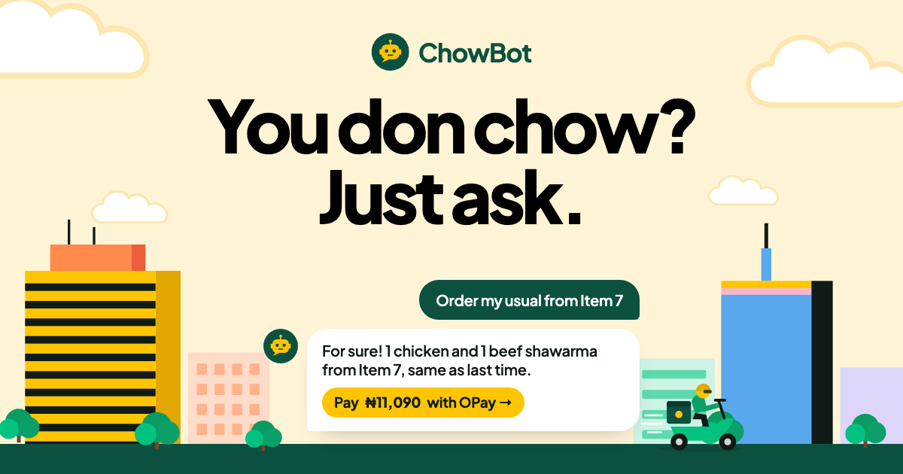

# ChowBot

## Order food from Chowdeck by chatting with AI

> Built with ❤️ by [me](https://adedoyin.dev) | [X](https://x.com/Emmysoft_Tm) | [LinkedIn](https://linkedin.com/in/Adedoyin-Emmanuel)

- Visit the website: https://chowbot.adedoyin.dev
- MCP server URL: https://chowbot-mcp.adedoyin.dev



ChowBot is an MCP server that connects your Chowdeck account to Claude, ChatGPT or any assistant that supports MCP. Ask for your usual, and it finds the restaurant, fills your cart, sends you Chowdeck's payment link, then tracks your rider and gets your delivery PIN.

You sign in with your Chowdeck phone number and the code Chowdeck texts you. Nothing is charged until you pay through Chowdeck's own link.

## Use it

Add `https://chowbot-mcp.adedoyin.dev` as a custom connector in your assistant, sign in, then try:

> What's on my Chowdeck cart?

## Run it locally

```sh
bun install
docker compose up -d db          # PostgreSQL
cp mcp-server/.env.example mcp-server/.env

bun run --cwd mcp-server dev     # MCP server on :2800
bun run --cwd auth dev           # sign-in pages on :2801 with a fake Chowdeck (code 1234)
bun run --cwd web dev            # website on :3000

bun run test
```

- `mcp-server/`: the MCP server, Chowdeck tools, OAuth and PostgreSQL
- `auth/`: the sign-in pages the server shows at `/authorize`
- `web/`: the website

ChowBot is an independent project, not affiliated with Chowdeck. [MIT License](./LICENSE).

## Find me

- Portfolio: https://adedoyin.dev
- GitHub: https://github.com/Adedoyin-Emmanuel
- X: https://x.com/Emmysoft_Tm
- LinkedIn: https://linkedin.com/in/Adedoyin-Emmanuel
